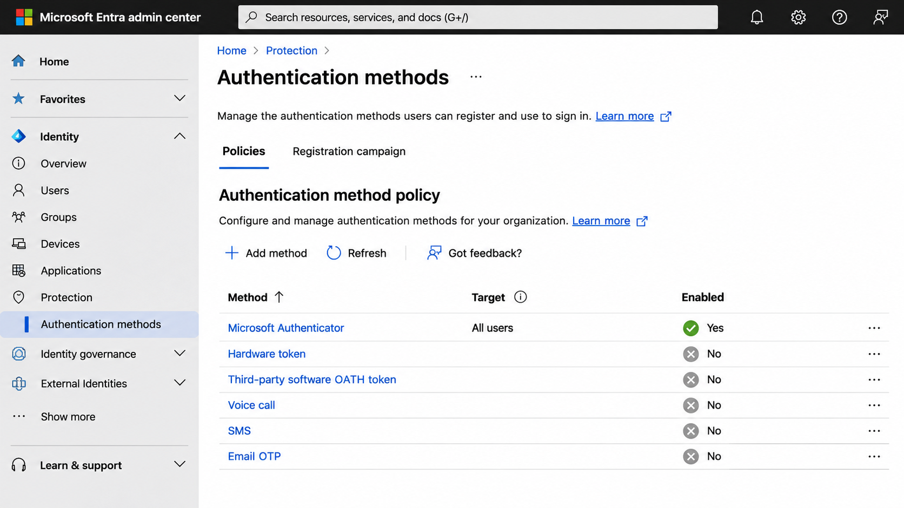
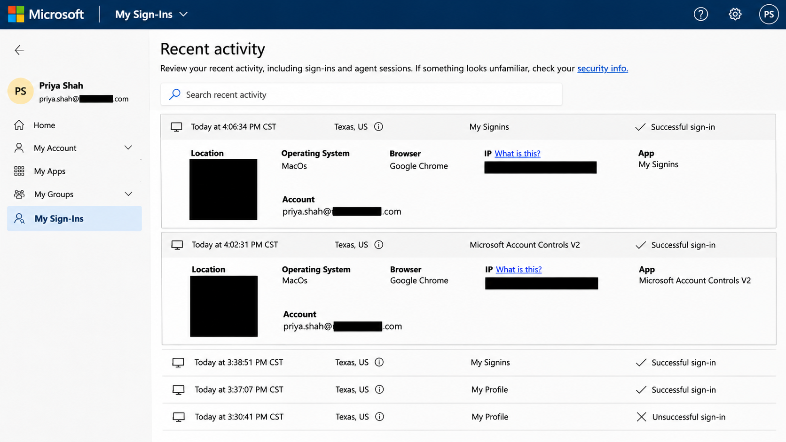
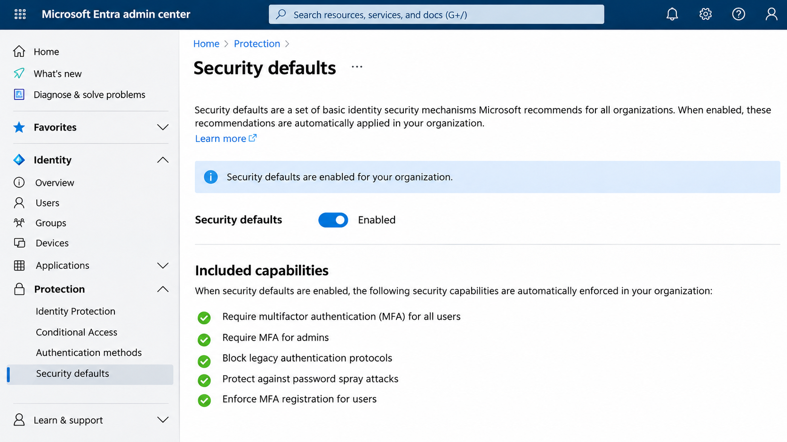
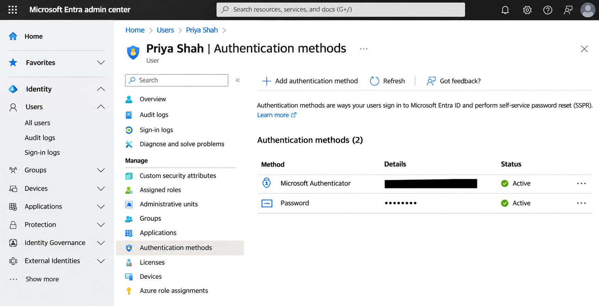
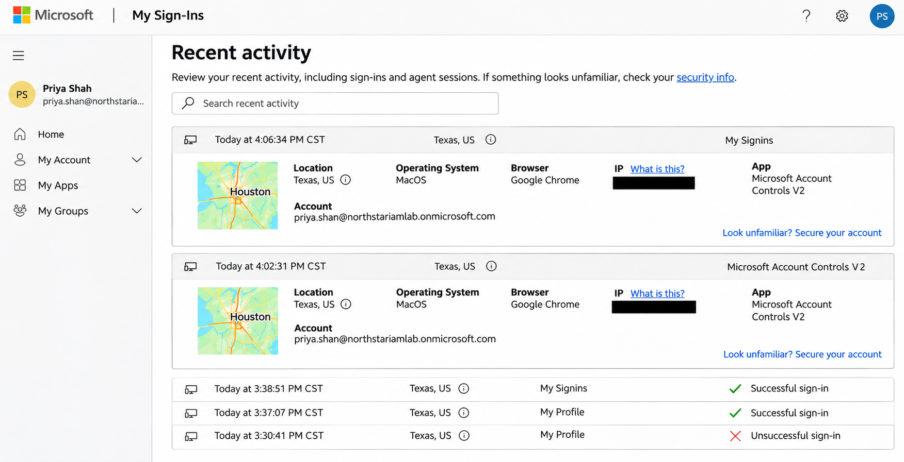

# Microsoft Entra MFA & Authentication Security

## Overview

This case study evaluates multifactor authentication (MFA) and authentication security in Microsoft Entra ID for Northstar Technologies, a fictional organization.

The implementation focuses on verifying baseline tenant protections, reviewing authentication method policies, registering Microsoft Authenticator for a fictional workforce identity, and observing an MFA sign-in challenge.

The lab also documents the licensing boundary between Microsoft Entra Free and Premium capabilities.

## Business Scenario

Northstar Technologies needs to protect workforce accounts against password-only compromise while maintaining a practical authentication experience.

The organization requires an approach that can:

- Verify baseline identity security protections.
- Review which authentication methods are available.
- Enroll a test workforce identity in Microsoft Authenticator.
- Validate the MFA user experience.
- Review sign-in activity.
- Identify security capabilities unavailable under current licensing.

## Authentication Architecture

The authentication workflow is:

**Workforce Identity → Password Authentication → Microsoft Authenticator MFA → Access**

Security Defaults were already enabled in the tenant. The lab verified this existing configuration rather than newly enabling it.

## Environment

- **Identity Platform:** Microsoft Entra ID
- **Organization:** Northstar Technologies (fictional)
- **Environment:** Cloud-only lab tenant
- **Test Identity:** Priya Shah — Engineering
- **Authentication Method:** Microsoft Authenticator push MFA
- **Licensing:** Microsoft Entra Free; no Premium license SKUs observed

> **Scope note:** This is an isolated IAM portfolio lab, not a production deployment. No Conditional Access policy was created, and tenant-wide authentication method settings were not modified.

## Authentication Method Review

The tenant's authentication method policies were inspected.

| Method | Observed Policy State |
|---|---|
| Microsoft Authenticator | Enabled |
| FIDO2 passkeys | Enabled |
| Temporary Access Pass | Enabled |
| Software OATH tokens | Enabled |
| Email OTP | Enabled |
| SMS | Disabled |
| Voice call | Disabled |
| Hardware OATH tokens | Disabled |

A method being enabled in a policy is not proof that a particular user has registered or used it.

## MFA Registration Workflow

### Initial State

Priya Shah was an enabled fictional Engineering user with no assigned administrative roles.

Before enrollment, the user's Authentication methods page showed no usable methods and no default sign-in method.

### Implementation Steps

1. Reviewed the test identity and existing authentication methods.
2. Initiated an administrator password reset for the fictional test identity.
3. Signed in using an isolated browser session and completed the required first-sign-in password change.
4. Followed Microsoft's Microsoft Authenticator registration prompt.
5. Confirmed that the user's Security info page listed **Microsoft Authenticator — Push multi-factor authentication (MFA)** on an iPhone.

### Result

The fictional test identity had a registered Microsoft Authenticator push method.

No tenant-wide authentication method policies were changed.

## MFA Sign-in Validation

A fresh sign-in for Priya Shah displayed a Microsoft Authenticator number-matching challenge.

The user's recent activity page also showed successful sign-in entries.

**Evidence interpretation:** The screenshots demonstrate a registered Authenticator method, an MFA challenge, and successful sign-in activity. The activity screenshot does not independently establish the precise factors used in every successful sign-in.

## Licensing Limitations

The following Premium-dependent capabilities were unavailable:

- **Conditional Access:** The Policies page reported insufficient licensing.
- **User Registration Details:** The authentication methods registration report returned an access error indicating that a Microsoft Entra Premium license was required.

The lab did not bypass these limitations or claim that Conditional Access policies were deployed.

## Testing and Validation

| Control | Observed Evidence | Result |
|---|---|---|
| Security Defaults | Tenant Properties showed protection enabled | Verified existing state |
| Authentication methods | Policy settings reviewed | Verified |
| Test identity | Enabled fictional Engineering user | Verified |
| Microsoft Authenticator | Push MFA shown in Security info | Registered |
| MFA prompt | Number-matching challenge shown | Observed |
| Recent activity | Successful sign-in entries visible | Observed |
| Conditional Access | Premium licensing required | Out of scope |

## Security Reasoning

MFA adds a verification step beyond the password, reducing reliance on a single credential. Number matching helps users distinguish an expected sign-in from an unsolicited approval request.

Tenant-wide policy availability, user enrollment, and successful authentication are distinct verification points and should be documented separately.

## Troubleshooting Perspective

If MFA does not work as expected, investigate:

- Whether the intended tenant and user are selected.
- Whether the authentication method is enabled by policy.
- Whether the user has registered a usable method.
- Whether a fresh sign-in triggers the expected challenge.
- Whether sign-in logs and licensing permit detailed validation.

## Implementation Illustrations

The five images below are **AI-generated reconstructions**, provided for visual context and presentation. They are **not original Microsoft Entra screenshots** and must not be used as verification of any policy, registration, or sign-in outcome. The original lab observations are documented in the sections above.

### 01 — Authentication Method Policies

### 02 — Recent Sign-in Activity

### 03 — Security Defaults

### 04 — User Authentication Methods

### 05 — Additional Sign-in Activity View

All five illustrations are now individually available in the [image folder](screenshots/). An earlier ZIP archive remains in that folder for convenience.

## Implementation Evidence & Sanitization

The real lab observations include Security Defaults already enabled, authentication policy review, Microsoft Authenticator enrollment for a fictional test identity, a number-matching MFA challenge, and successful sign-in entries.

**Authentic screenshots are not yet published individually in this repository.** The illustrations above do not establish these outcomes. Original evidence should be uploaded only after verifying that all credentials, enrollment QR codes, IP addresses, and other sensitive identifiers have been removed or masked.

This distinction is important for portfolio credibility: **documented implementation claims and AI-generated explanatory visuals are separate artifacts**.

## SC-300 Alignment

This lab reinforces Microsoft Identity and Access Administrator concepts including authentication method policies, multifactor authentication registration, tenant baseline security controls, sign-in validation, and licensing considerations for Conditional Access and reporting.

## Key Takeaways

- Security Defaults and Conditional Access are different tenant security capabilities.
- Authentication policy configuration does not establish individual user registration.
- Registration and sign-in challenges should be validated independently.
- Licensing limitations are valid findings when clearly documented.
- IAM evidence should be sanitized before public publication.

---

**Portfolio:** [IAM Engineering Portfolio](https://github.com/ShemarIAM-19/iam-engineering-portfolio)
